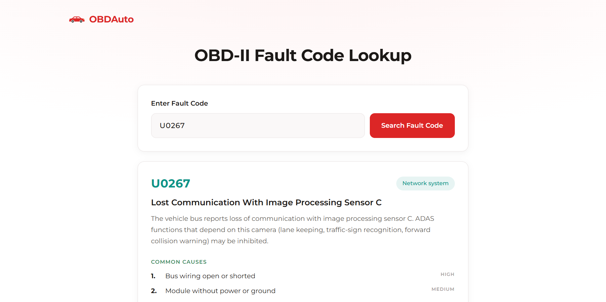

# OBDAuto: OBD-II Fault Code Lookup

A web tool for looking up OBD-II diagnostic trouble codes. Enter a code such as P0420 and see what it means, the most likely causes and the typical symptoms.

---

## Live Demo

https://oussama-dalhi.github.io/obdcode-lockup/

---

## Screenshot



---

## Features

* Look up generic OBD-II codes in all four systems: Powertrain (P), Body (B), Chassis (C) and Network (U)
* Description of each code, with common causes ranked by likelihood
* Typical symptoms for each code
* Data is split into one JSON file per code family and loaded only when needed
* Inline validation and clear messages for invalid or unknown codes
* Responsive layout for desktop and mobile

---

## What This Project Demonstrates

* Fetching, validating and caching JSON data on demand
* Splitting a small app into ES modules (`main`, `data`, `render`)
* Rendering dynamic HTML safely by escaping all data
* Accessible form feedback with `aria-live` and `aria-invalid`
* Preparing a public dataset into small files a static site can load quickly

---

## Tech Stack

* HTML5
* CSS3
* JavaScript (ES modules)

---

## Project Structure

```plaintext
.
├── index.html
├── README.md
├── image.png
├── data/
│   └── codes/
│       ├── B0.json
│       ├── C0.json
│       ├── P0.json
│       ├── P2.json
│       ├── P3.json
│       ├── U0.json
│       └── U3.json
└── src/
    ├── assets/
    │   └── favicon.svg
    ├── css/
    │   └── style.css
    └── js/
        ├── main.js
        ├── data.js
        └── render.js
```

---

## Getting Started

```bash
git clone https://github.com/oussama-dalhi/obdcode-lockup.git
cd obdcode-lockup
```

The app uses ES modules and `fetch`, which browsers block on `file://` URLs, so serve the folder with a local server instead of opening `index.html` directly:

* In VS Code, install the Live Server extension and click "Go Live".
* Or run `npx serve` in the project folder.

---

## Data

The files in `data/codes/` come from the [OBDex](https://github.com/foerbsnavi/OBDex) dataset, which is released under CC0. They were converted once into one JSON file per code family, keeping only the fields the app uses: title, description, common causes with likelihood, and symptoms. The German text and repair estimates were left out.

Each file is an object keyed by code, so a lookup is a single property access:

```json
{
  "P0420": {
    "title": "Catalyst System Efficiency Below Threshold (Bank 1)",
    "description": "...",
    "causes": [{ "label": "Catalyst aged or contaminated", "likelihood": "high" }],
    "symptoms": ["Check engine light on"]
  }
}
```

---

## Limitations

* Only generic (SAE) codes are included. Manufacturer-specific codes such as P1xxx and B1xxx are not in the dataset, so searching for them shows a "not found" message.
* Causes and likelihoods are general guidance for each code, not a diagnosis of a specific vehicle.

---

## Future Improvements

* Clickable related codes
* Affected components for each code
* German translation (the dataset already includes German text)
* Autocomplete suggestions while typing
* Support for manufacturer-specific codes

---

## Contributing

Contributions are welcome. Fork the repository, create a branch and open a pull request.

---

## Disclaimer

This tool provides general information about OBD-II codes. A code describes a symptom, not a confirmed fault. It does not replace professional vehicle diagnostics, so always check the vehicle's service documentation before replacing parts.

---

## Acknowledgements

* Code data from [OBDex](https://github.com/foerbsnavi/OBDex), released under CC0
* Font: Montserrat via Google Fonts
* Built as part of learning JavaScript and building real-world applications